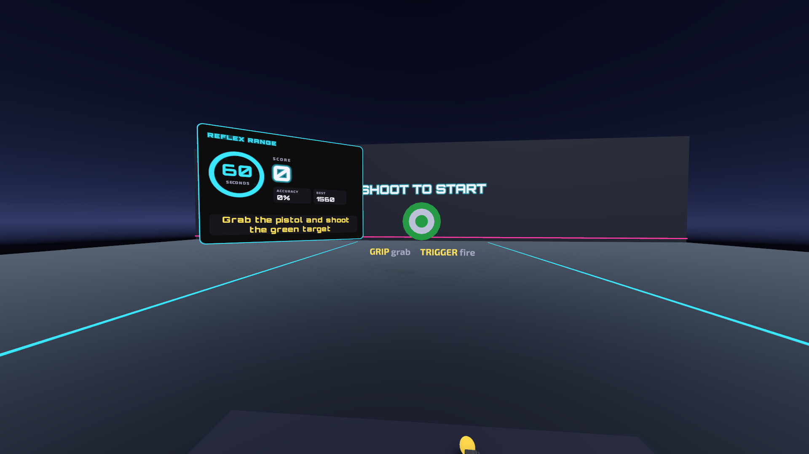
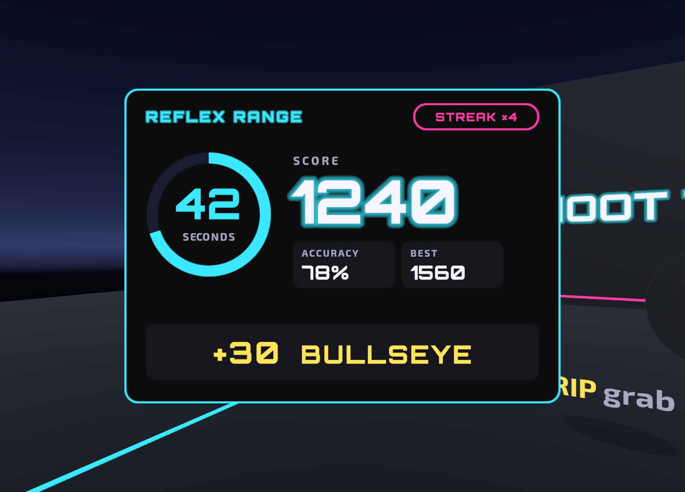
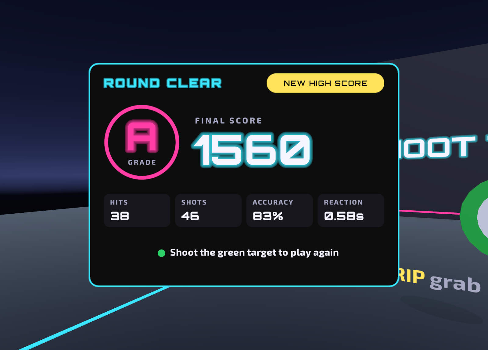

# Reflex Range VR

A stationary VR **reaction and aim trainer** for **Meta Quest 3**, made with Unity 6 and the XR Interaction Toolkit.
Midterm project for *AR/VR Systems and Applications* (Week 8 project checkpoint).

## Team

| Member | Role |
|---|---|
| Mirjalol | Solo developer: idea, XR interaction, C# scripts, UI design, testing, presentation |

## Problem and use case

Reaction speed and aim are hard to practise and hard to measure:

- a mouse on a flat screen does not train real arm and hand movement,
- most practice gives no numbers (accuracy, reaction time, progress),
- many VR games move the player and make beginners feel motion sick.

**Reflex Range VR** puts the player at a shooting-range counter. They grab a pistol and hit targets that pop up around them for 60 seconds. The game measures score, accuracy and average reaction time. The player never moves, so there is no motion sickness. XR fits because the player uses real depth and real arm movement with 6DoF tracked controllers.

## Features (current MVP)

- Grab the pistol (direct or ray grab) and shoot with the trigger: raycast hit, laser line, muzzle flash, sound and controller vibration
- Realistic pistol model; the controller model hides while the pistol is held; a dropped pistol returns to the counter
- Target spawner: random positions in front of the player, moving targets, faster spawning during the round
- Ring scoring (10 / 20 / 30 points, moving targets x2), hit streak, accuracy and reaction time
- Neon world-space scoreboard with a timer ring, and a results screen with a grade (S/A/B/C) and best score
- Floating "+points" pop-ups at each hit
- Stationary XR rig (snap turn only), tested in the Editor with the XR Interaction Simulator, builds as a Quest 3 APK

| During a round | Results |
|---|---|
|  |  |

## How to play

1. Pick up the pistol from the counter with **Grip**.
2. Shoot the green **START** target with **Trigger**. A 60-second round starts.
3. Hit the targets that pop up. Closer to the centre = more points. Blue targets move and are worth double.
4. After 60 seconds the scoreboard shows your grade, accuracy and reaction time. Shoot the green target to play again.

| Action | Quest 3 controllers | Unity Editor (XR Interaction Simulator) |
|---|---|---|
| Choose the right controller | – | `]` (`[` = left, `H` = head, `Tab` = cycle) |
| Aim | Point the controller | Hold right mouse button + move the mouse |
| Pick up the pistol | Grip | `G` |
| Shoot | Trigger | `T` |
| Turn | Right thumbstick (snap turn) | – |
| Move the simulated device | – | `W A S D`, `Q E` (`R` = reset) |

## Install on Meta Quest 3

1. Download **ReflexRangeVR.apk** from the [Releases](../../releases) page.
2. The headset must be in Developer Mode.
3. Install it with Meta Quest Developer Hub (drag and drop the APK) or with `adb install -r ReflexRangeVR.apk`.
4. In the headset open **Library → Unknown Sources → Reflex Range VR**.

## Open and build the project

**Requirements:** Unity **6000.6.5f1** with **Android Build Support** (OpenJDK, Android SDK & NDK), installed through Unity Hub.

1. Clone the repository or use **Code → Download ZIP**.
2. In Unity Hub choose **Add → Add project from disk** and select the folder. The first opening takes a few minutes (packages are downloaded and the Library folder is rebuilt).
3. Open the scene `Assets/ReflexRange/Scenes/ReflexRange.unity` and press **Play** to test with the XR Interaction Simulator.
4. To build for Quest: **File → Build Profiles → Android → Switch Platform**, then use the menu **Reflex Range → 4. Build APK for Quest**. The APK is written to `Builds/ReflexRangeVR.apk`.

The menu **Reflex Range** also contains the setup steps that were used to create the project (import XR samples, configure Quest 3 settings, build the game scene). They are already done; running **3. Build Game Scene** again recreates the scene from code.

## How it works

| Script | What it does |
|---|---|
| `Pistol.cs` | `XRGrabInteractable`: grip = *select* picks it up, trigger = *activate* fires a `Physics.Raycast` from the muzzle. Laser, sound, haptics, hides the controller model, returns to the counter when dropped. |
| `IShootable.cs` | Interface for everything that can be shot, so the pistol does not need to know what it hit. |
| `Target.cs` | Pop-up animation, points by distance from the centre (x1/x2/x3), reaction time, disappears after a few seconds. |
| `MovingTarget.cs` | Moves the target left and right with `Time.deltaTime`. |
| `TargetSpawner.cs` | Instantiates target prefabs at random places in front of the player, faster as the round goes on. |
| `StartTarget.cs` | The green target that starts a round. |
| `GameManager.cs` | 60-second round, score, streak, accuracy, reaction time, grade and best score (saved with `PlayerPrefs`). |
| `ScoreboardUI.cs` | World-space TextMeshPro canvas with a live panel and a results panel. |
| `HitPopup.cs` | Floating "+30" text that rises and fades. |
| `SoundMaker.cs` | Creates the shot and hit sounds in code (no audio files). |
| `Editor/ReflexRangeSetup.cs` | Editor tool: project setup for Quest 3, scene builder and APK build. |

**Technical setup:** Unity 6000.6.5f1, URP, XR Interaction Toolkit 3.6.1 (Starter Assets XR rig), OpenXR 1.18 with Meta Quest Support and Touch / Touch Plus controller profiles, Android ARM64, IL2CPP, Vulkan, minimum API level 32, 4x MSAA.

## Credits and licences

- 3D model: **"Pistol"** (https://skfb.ly/oxEBv) by **h1ggs**, licensed under [Creative Commons Attribution 4.0](http://creativecommons.org/licenses/by/4.0/). Imported into Unity; materials were set up for URP.
- Fonts: **Orbitron** (The Orbitron Project Authors) and **Exo 2** (The Exo 2 Project Authors), SIL Open Font License 1.1. Licence texts: `Assets/ReflexRange/Fonts/Orbitron-OFL.txt` and `Exo2-OFL.txt`.
- XR Interaction Toolkit samples (Starter Assets, XR Interaction Simulator) and TextMesh Pro resources © Unity Technologies, under the Unity Companion License.
